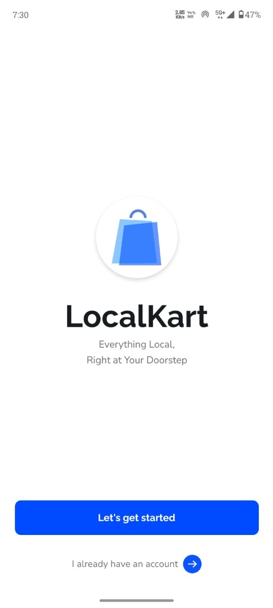
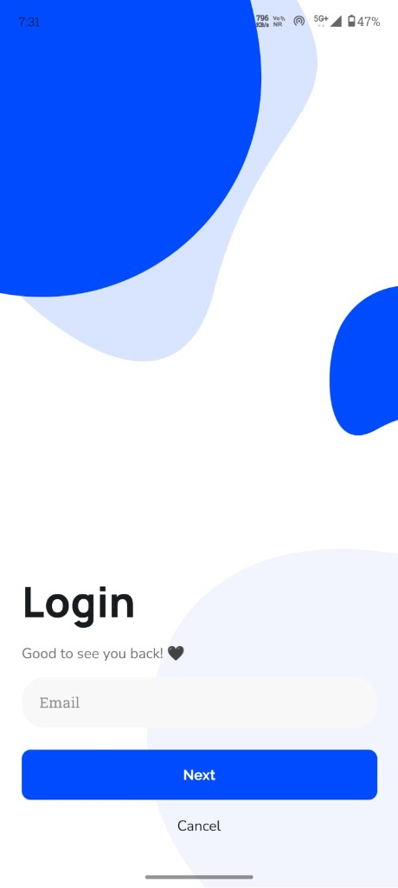
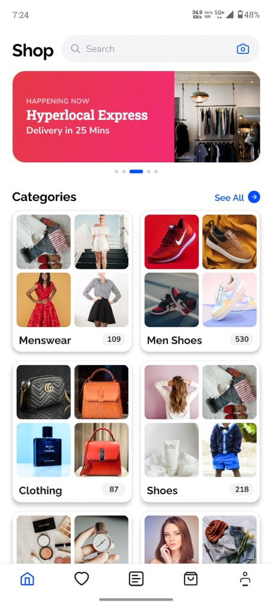
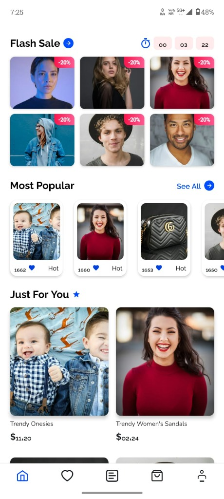
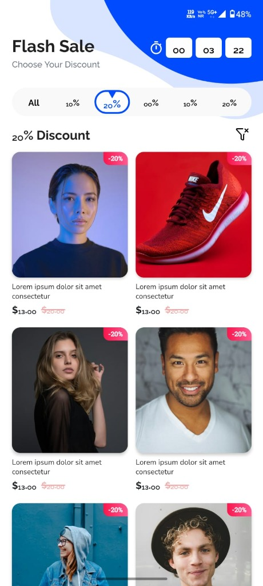
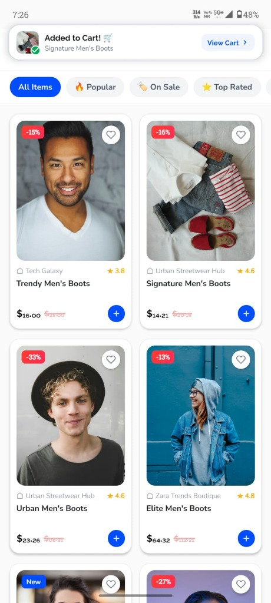
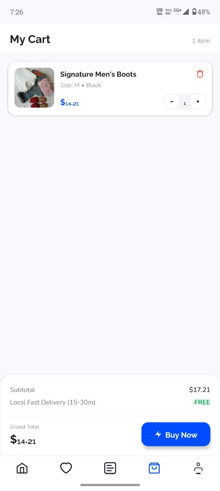
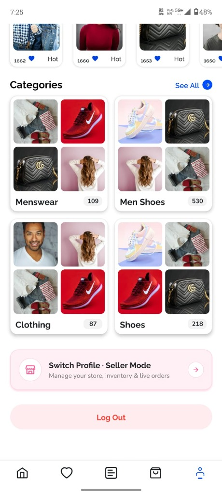

# 🛒 LocalKart — Hyperlocal E-Commerce & Marketplace App

<p align="center">
  <b>A modern, high-performance hyperlocal e-commerce mobile application connecting local shoppers with neighborhood stores and vendors.</b>
</p>

<p align="center">
  
  
  
  
  
  
</p>

---

## 🌟 Overview

**LocalKart** bridges the gap between local retail shops and consumers by providing a seamless, fast, and feature-packed shopping experience. Built with **React Native** and powered by **Supabase**, it supports dual roles (**Customer** & **Vendor**) with real-time order tracking, in-app chat, calling, flash sales, and complete vendor store management.

---

## 📱 App Screenshots

<div align="center">

### 🚀 Onboarding, Auth & Home Experience

| Welcome & Onboarding | Login Flow | Home & Hyperlocal Express | Flash Sale & Timer |
| :---: | :---: | :---: | :---: |
|  |  |  |  |

### 🛍️ Deals, Catalog & Checkout

| Discount Filter (20% Off) | Product Catalog & Cart Toast | My Cart & Checkout | Categories & Seller Switch |
| :---: | :---: | :---: | :---: |
|  |  |  |  |

</div>

---

## ✨ Key Features


### 🛍️ Customer Experience
- **Interactive Home Screen**: Dynamic hero banners, stories, flash sale countdown timer, top circular product highlights, and categorized feeds.
- **Advanced Search & Filters**: Filter by price, category, rating, and discounts.
- **Product Details & Cart**: Rich product imagery via FastImage, variant selection, and cart state management.
- **Authentication Flow**: Smooth onboarding, OTP verification, secure password reset, and dynamic bubble animations.
- **In-App Messaging & Calling**:
  - **Realtime Chat**: Instant communication with store owners, typing indicators, pinned product cards, and media attachments.
  - **Audio/Video Calling**: In-app calling engine for instant vendor-customer coordination.
- **Push Notifications**: Firebase Cloud Messaging (FCM) for real-time order and deal updates.

### 🏪 Vendor / Store Portal
- **Step-by-Step Onboarding**:
  - Business Information & Hyperlocal Address verification
  - Penny Drop & Bank payout verification
  - GST / Tax & Legal document upload
  - Under-review & Approval tracking
- **Store & Inventory Management**:
  - Real-time catalog & product listing management
  - Order fulfillment workflow (Pending, Processing, Delivered)
  - Custom business hours, temporary closure, and special holiday scheduling
- **Vendor Wallet**: Track daily earnings, payouts, and order analytics.

---

## 🛠️ Tech Stack

| Category | Technology |
|---|---|
| **Framework** | [React Native 0.87](https://reactnative.dev) (CLI) |
| **Language** | [TypeScript](https://www.typescriptlang.org) |
| **State Management** | [Redux Toolkit](https://redux-toolkit.js.org) + React-Redux |
| **Backend & Database** | [Supabase](https://supabase.com) (PostgreSQL, Auth, Storage, Realtime) |
| **Styling & Design System** | [@shopify/restyle](https://github.com/Shopify/restyle), Linear Gradient, Custom Typography (Raleway) |
| **Animations** | [React Native Reanimated](https://docs.swmansion.com/react-native-reanimated/) |
| **Navigation** | [React Navigation 7](https://reactnavigation.org) (Native Stack, Bottom Tabs) |
| **Forms & Validation** | React Hook Form + Zod |
| **Push Notifications** | [@react-native-firebase/messaging](https://rnfirebase.io/messaging/usage) |
| **Icons & Media** | Lucide Icons, Fast Image, SVG Transformer |

---

## 📁 Project Structure

```text
LocalKart/
├── android/                        # Android native configuration, Gradle & Fastlane
├── docs/                           # Documentation & UI preview screenshots
│   └── screenshots/                # Application screen captures
├── ios/                            # iOS native code, Podfile & configuration
├── scripts/                        # Utility & post-install scripts (patch-raleway)
├── src/
│   ├── assets/                     # App static assets
│   │   ├── fonts/                  # Raleway font family (Regular, Medium, SemiBold, Bold, ExtraBold)
│   │   ├── icons/                  # Vector icons & symbols
│   │   ├── png/                    # Image assets & backgrounds
│   │   └── svg/                    # SVG assets & vector graphics
│   ├── components/                 # Reusable atomic UI components
│   │   ├── AppImage.tsx            # FastImage wrapper with caching & fallbacks
│   │   ├── Button.tsx              # Themed customizable buttons
│   │   ├── FloatingModal.tsx       # Bottom sheets and floating modals
│   │   ├── ProfilePhotoPickerModal.tsx
│   │   ├── ShimmerPlaceholder.tsx  # Loading skeleton animations
│   │   └── ToastNotification.tsx   # Custom animated toasts
│   ├── config/                     # App configuration & environment loader (env.ts)
│   ├── constants/                  # App constants & global static configurations
│   ├── dev/                        # Developer tools & profiling helpers (profilerLog.ts)
│   ├── features/                   # Core business features (Domain-driven structure)
│   │   ├── auth/                   # Authentication (Login, OTP, Signup, Password Reset, DynamicBubbles)
│   │   ├── call/                   # Calling Engine (WebRTC Signaling, ActiveCall, IncomingCallModal)
│   │   ├── cart/                   # Cart management & summary
│   │   ├── chat/                   # Real-time messaging (ChatRoom, Messages, Audio/Media, PinnedProducts)
│   │   ├── home/                   # Home experience (Hero Carousel, Flash Sales, Categories, Story Cards)
│   │   ├── orders/                 # Customer order management & tracking
│   │   ├── product/                # Product details, category listings, and filter modals
│   │   ├── profile/                # User profile, addresses & account settings
│   │   └── wishlist/               # Saved & favorited items
│   ├── firebase-config/            # Firebase Cloud Messaging & background handlers (FCM)
│   ├── hooks/                      # Custom shared React hooks
│   ├── lib/                        # Third-party client setups (supabase.ts client initialization)
│   ├── navigation/                 # Navigation setup (RootNavigator, TabNavigator, Route types)
│   ├── role/                       # Role selection flow (Customer vs. Vendor onboarding choice)
│   ├── services/                   # Business services & data layers (homeService.ts)
│   ├── store/                      # Redux Toolkit store, hooks & feature slices (authSlice, cartSlice)
│   ├── theme/                      # Shopify Restyle theme system (palette, colors, typography, tokens)
│   ├── types/                      # TypeScript definitions (database.ts, user.ts, declarations.d.ts)
│   ├── utils/                      # Helper utilities (discount calculation, imageResolver, avatar storage)
│   └── vendor/                     # Dedicated Vendor Portal
│       ├── components/             # Vendor onboarding steps, KYC, penny drop & business hours modals
│       ├── hooks/                  # Vendor specific lifecycle hooks (useStoreStatus)
│       ├── navigation/             # VendorNavigator
│       ├── screens/                # Dashboard, Inventory, Products, Orders, Store Settings, Wallet
│       ├── store/                  # Vendor slices (vendorOnboardingSlice, vendorStoreSlice)
│       ├── types/                  # Vendor data contracts & store profile interfaces
│       └── utils/                  # Store operational state & time helper logic
├── supabase/                       # Supabase database migrations, schema & seed data
│   ├── schema.sql                  # Database tables, triggers, and RLS security policies
│   ├── seed_data.sql               # Default seed products and store records
│   └── fashion_seed.sql            # Fashion category sample data
├── babel.config.js                 # Babel plugins & module resolvers
├── package.json                    # Project dependencies and npm scripts
└── tsconfig.json                   # TypeScript configuration
```

---

## 🚀 Getting Started

### Prerequisites

- **Node.js**: `>= 22.11.0`
- **JDK**: Version 17
- **Android Studio** (Android SDK & Emulator / Physical Device)
- **Git**

### Installation

1. **Clone the repository:**
   ```bash
   git clone https://github.com/govindnirvel-tech/LocalKart.git
   cd LocalKart
   ```

2. **Install dependencies:**
   ```bash
   npm install
   # or
   yarn install
   ```

3. **Configure Environment Variables:**
   Create a `.env` file in the root directory by copying `.env.example`:
   ```bash
   cp .env.example .env
   ```
   Add your **Supabase URL**, **Supabase Anon Key**, and **Firebase** credentials.

4. **Database Setup:**
   Run the scripts inside `/supabase` in your Supabase SQL editor:
   - `schema.sql` (Tables, RLS policies, triggers)
   - `seed_data.sql` / `fashion_seed.sql` (Sample products and categories)

---

## 📱 Running the Application

### Start Metro Bundler:
```bash
npm start
# or
yarn start
```

### Run on Android:
```bash
npm run android
# or
yarn android
```

### Run on iOS (macOS required):
```bash
bundle install
cd ios && bundle exec pod install && cd ..
npm run ios
# or
yarn ios
```

---

## 🤝 Contributing

Contributions are welcome! Please follow these steps:
1. Fork the repository.
2. Create your feature branch (`git checkout -b feature/AmazingFeature`).
3. Commit your changes (`git commit -m 'feat: Add some AmazingFeature'`).
4. Push to the branch (`git push origin feature/AmazingFeature`).
5. Open a Pull Request.

---

## 📄 License

This project is licensed under the [MIT License](LICENSE).
